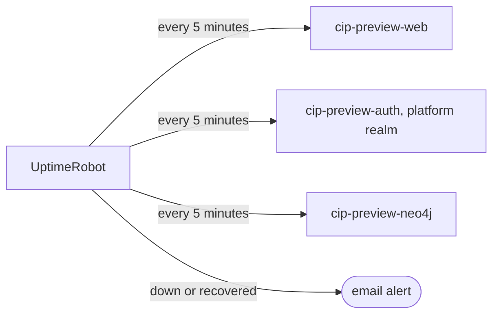

# Monitoring and analytics

**Last updated:** 2026-11-25

## Uptime

UptimeRobot, HTTP checks every 5 minutes, email alerts. Monitored:

- `https://cip-preview-web.sploosh.ai/`
- `https://cip-preview-auth.sploosh.ai/realms/platform`
- `https://cip-preview-neo4j.sploosh.ai/`

A passing check means the address answered. It does not test sign-in or a graph query.

## Analytics and error tracking

No analytics or error tracking service was found in the code on 2026-11-25. If one is added, record the
events here and what is never collected.
